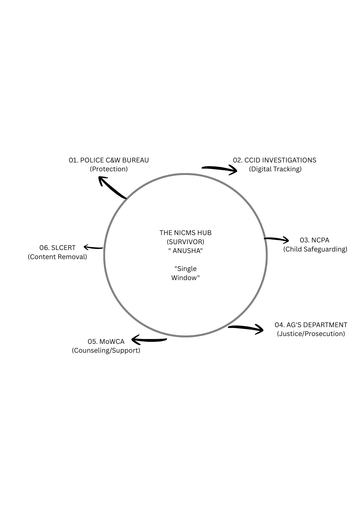

# NICMS: National Integrated Case Management System (Sri Lanka)
### Strategic Blueprint for SGBV & TFGBV Digital Transformation

**Role:** Business Analyst (Role Challenge - Loons Lab)
**Candidate:** Abishek Pranav GV
**Status:** Strategic Design Phase

## 01. The Problem: "The Trauma of the Loop"
In Sri Lanka, survivors of SGBV/TFGBV face a fragmented bureaucratic maze. Reporting a crime requires navigating 6 different agencies, forcing victims to relive their trauma through repetitive storytelling. 

**The Goal:** Unify these "six giants" into a **Single Window of Truth** that prioritizes survivor safety as much as legal efficiency.

## 02. The Solution: Single Window Architecture
The NICMS Hub serves as a secure, API-driven bridge between:
1. Police C&W Bureau
2. CCID (Digital Tracking)
3. NCPA (Child Safeguarding)
4. AG's Department (Prosecution)
5. MoWCA (Counseling/Support)
6. SLCERT (Content Removal)

🔗 **[Launch Live Interactive Prototype](https://nicms-srilanka-blueprint.netlify.app/)** *(Experience the interactive "Anusha" survivor intake journey and witness the 4-hour SLA Handshake protocol in real-time.)*

## 03. Key BA Innovations
- **Ghost-Tracking:** 16-digit 'Justice Key' for anonymous status tracking on shared devices.
- **Evidence Time-Capsule:** Automated SHA-256 hashing for court-admissible digital evidence.
- **The Safety Exit:** A "Panic Button" that instantly masks the user's activity.
- **Inter-Agency Handshake:** Digital referral system with a defined 4-hour SLA to prevent case stalling.

## 04. Technical & Functional Specs
- **Logic:** Lead Agency Ownership model.
- **Security:** Zero-Knowledge Encryption for survivor PII.
- **Capability:** Offline-first caching for rural accessibility.

---
*"We move from Bureaucracy to Protection."*

---

## 🌐 Complete Live Run & CI/CD Verification (24 Repositories)

Official production verification matrix for [Abishek Pranav G V](https://abishekpranavgv.github.io/abishekpranavportfolio/) ecosystem:

| # | Repository | Tech Stack & Workflow | Status | Live Run Link | Live App / Pages URL |
|---|---|---|:---:|:---:|:---:|
| 1 | [abishekpranavportfolio](https://github.com/AbishekPranavGV/abishekpranavportfolio) | TypeScript / React / Vite CI & Pages Deploy | ✅ Success | [Run #39437493630](https://github.com/AbishekPranavGV/abishekpranavportfolio/actions/runs/39437493630) | [abishekpranavgv.github.io/abishekpranavportfolio](https://abishekpranavgv.github.io/abishekpranavportfolio/) |
| 2 | [Retail-Sales-Performance-Predictive-Analytics](https://github.com/AbishekPranavGV/Retail-Sales-Performance-Predictive-Analytics) | Executive Dashboard & Pages Deploy | ✅ Success | [Run #39437771618](https://github.com/AbishekPranavGV/Retail-Sales-Performance-Predictive-Analytics/actions/runs/39437771618) | [abishekpranavgv.github.io/Retail-Sales-Performance-Predictive-Analytics](https://abishekpranavgv.github.io/Retail-Sales-Performance-Predictive-Analytics/) |
| 3 | [NICMS-SriLanka-Strategic-Blueprint](https://github.com/AbishekPranavGV/NICMS-SriLanka-Strategic-Blueprint) | Static Site Verification & Pages Deploy | ✅ Success | [Run #39437769957](https://github.com/AbishekPranavGV/NICMS-SriLanka-Strategic-Blueprint/actions/runs/39437769957) | [abishekpranavgv.github.io/NICMS-SriLanka-Strategic-Blueprint](https://abishekpranavgv.github.io/NICMS-SriLanka-Strategic-Blueprint/) |
| 4 | [social-command-center](https://github.com/AbishekPranavGV/social-command-center) | Node.js 20 / Next.js Syntax & CI Validation | ✅ Success | [Run #39438319857](https://github.com/AbishekPranavGV/social-command-center/actions/runs/39438319857) | [nunes-social-post-machine-mu.vercel.app](https://nunes-social-post-machine-mu.vercel.app) |
| 5 | [IndiaMART-AI-Content-Catalog-Generator](https://github.com/AbishekPranavGV/IndiaMART-AI-Content-Catalog-Generator) | Next.js & Automation Bundle Validation | ✅ Success | [Run #39438327386](https://github.com/AbishekPranavGV/IndiaMART-AI-Content-Catalog-Generator/actions/runs/39438327386) | [nunes-social-post-machine-mu.vercel.app](https://nunes-social-post-machine-mu.vercel.app) |
| 6 | [MedX](https://github.com/AbishekPranavGV/MedX) | Python 3.11 Microservices & Endpoint CI | ✅ Success | [Run #39437852044](https://github.com/AbishekPranavGV/MedX/actions/runs/39437852044) | [nunes-catalogue-studio-live.vercel.app](https://nunes-catalogue-studio-live.vercel.app/) |
| 7 | [Streamlit](https://github.com/AbishekPranavGV/Streamlit) | Streamlit Requirements & App Validation | ✅ Success | [Run #39437832596](https://github.com/AbishekPranavGV/Streamlit/actions/runs/39437832596) | [blank-app-template.streamlit.app](https://blank-app-template.streamlit.app/) |
| 8 | [Climate-Impact-ESG-Dashboard](https://github.com/AbishekPranavGV/Climate-Impact-ESG-Dashboard) | Real-time ESG Notebook & Engine CI | ✅ Success | [Run #39437788309](https://github.com/AbishekPranavGV/Climate-Impact-ESG-Dashboard/actions/runs/39437788309) | — |
| 9 | [COVID-19-Global-Forecasting-Predictive-Analysis](https://github.com/AbishekPranavGV/COVID-19-Global-Forecasting-Predictive-Analysis) | Time-Series Forecasting Notebook CI | ✅ Success | [Run #39437782830](https://github.com/AbishekPranavGV/COVID-19-Global-Forecasting-Predictive-Analysis/actions/runs/39437782830) | — |
| 10 | [Customer-Churn-Decision-Analysis](https://github.com/AbishekPranavGV/Customer-Churn-Decision-Analysis) | Decision Analysis & Case Study CI | ✅ Success | [Run #39437795502](https://github.com/AbishekPranavGV/Customer-Churn-Decision-Analysis/actions/runs/39437795502) | — |
| 11 | [E-commerce-Recommendation-Engine](https://github.com/AbishekPranavGV/E-commerce-Recommendation-Engine) | Recommendation Model & CSV Dataset CI | ✅ Success | [Run #39437803215](https://github.com/AbishekPranavGV/E-commerce-Recommendation-Engine/actions/runs/39437803215) | — |
| 12 | [Facedetection](https://github.com/AbishekPranavGV/Facedetection) | OpenCV Cascades & Classifier Python CI | ✅ Success | [Run #39437808536](https://github.com/AbishekPranavGV/Facedetection/actions/runs/39437808536) | — |
| 13 | [Movie_recommendation_using_emotion](https://github.com/AbishekPranavGV/Movie_recommendation_using_emotion) | Emotion Recommender & Streamlit App CI | ✅ Success | [Run #39437816270](https://github.com/AbishekPranavGV/Movie_recommendation_using_emotion/actions/runs/39437816270) | — |
| 14 | [Stock-Price-Prediction-using-ARIMA](https://github.com/AbishekPranavGV/Stock-Price-Prediction-using-ARIMA) | ARIMA & LSTM Model Artifacts CI | ✅ Success | [Run #39437826761](https://github.com/AbishekPranavGV/Stock-Price-Prediction-using-ARIMA/actions/runs/39437826761) | — |
| 15 | [Sentimental-analysis-of-News-Headlines](https://github.com/AbishekPranavGV/Sentimental-analysis-of-News-Headlines) | NLP Sentiment Analysis Notebook CI | ✅ Success | [Run #39436975960](https://github.com/AbishekPranavGV/Sentimental-analysis-of-News-Headlines/actions/runs/39436975960) | — |
| 16 | [Autonomous-System-Temp-Cleaner](https://github.com/AbishekPranavGV/Autonomous-System-Temp-Cleaner) | Windows Automation & Cleaner Batch CI | ✅ Success | [Run #39437859122](https://github.com/AbishekPranavGV/Autonomous-System-Temp-Cleaner/actions/runs/39437859122) | — |
| 17 | [Crm](https://github.com/AbishekPranavGV/Crm) | AI CRM Skill Bundle & Preview Scripts CI | ✅ Success | [Run #39437863792](https://github.com/AbishekPranavGV/Crm/actions/runs/39437863792) | — |
| 18 | [drive-file-index](https://github.com/AbishekPranavGV/drive-file-index) | Google Drive Indexer Distribution CI | ✅ Success | [Run #39437872721](https://github.com/AbishekPranavGV/drive-file-index/actions/runs/39437872721) | — |
| 19 | [Multi-Account-Gmail-Inbox-Hygiene-Agent](https://github.com/AbishekPranavGV/Multi-Account-Gmail-Inbox-Hygiene-Agent) | Multi-Account Gmail Agent Bundle CI | ✅ Success | [Run #39437877580](https://github.com/AbishekPranavGV/Multi-Account-Gmail-Inbox-Hygiene-Agent/actions/runs/39437877580) | — |
| 20 | [NICMS-SriLanka-Strategic-Blueprint_Project](https://github.com/AbishekPranavGV/NICMS-SriLanka-Strategic-Blueprint_Project) | Project Blueprint Specs & Architecture CI | ✅ Success | [Run #39437882917](https://github.com/AbishekPranavGV/NICMS-SriLanka-Strategic-Blueprint_Project/actions/runs/39437882917) | — |
| 21 | [NUNES-Local-AI-Marketing-Starter](https://github.com/AbishekPranavGV/NUNES-Local-AI-Marketing-Starter) | Local AI Marketing Starter Bundle CI | ✅ Success | [Run #39437889129](https://github.com/AbishekPranavGV/NUNES-Local-AI-Marketing-Starter/actions/runs/39437889129) | — |
| 22 | [Smart-Brochure-to-Catalog-Converter](https://github.com/AbishekPranavGV/Smart-Brochure-to-Catalog-Converter) | PDF Catalog Converter Specification CI | ✅ Success | [Run #39437897042](https://github.com/AbishekPranavGV/Smart-Brochure-to-Catalog-Converter/actions/runs/39437897042) | — |
| 23 | [Smart-Price-Master-Catalog-Generator](https://github.com/AbishekPranavGV/Smart-Price-Master-Catalog-Generator) | PriceMaster Multi-OS Package CI | ✅ Success | [Run #39437902153](https://github.com/AbishekPranavGV/Smart-Price-Master-Catalog-Generator/actions/runs/39437902153) | — |
| 24 | [SocmedX](https://github.com/AbishekPranavGV/SocmedX) | Social Command Center Portfolio Bundle CI | ✅ Success | [Run #39437907375](https://github.com/AbishekPranavGV/SocmedX/actions/runs/39437907375) | — |

*Maintained by [Abishek Pranav G V](https://abishekpranavgv.github.io/abishekpranavportfolio/) · Business Analyst & Data/AI Automation Specialist*
